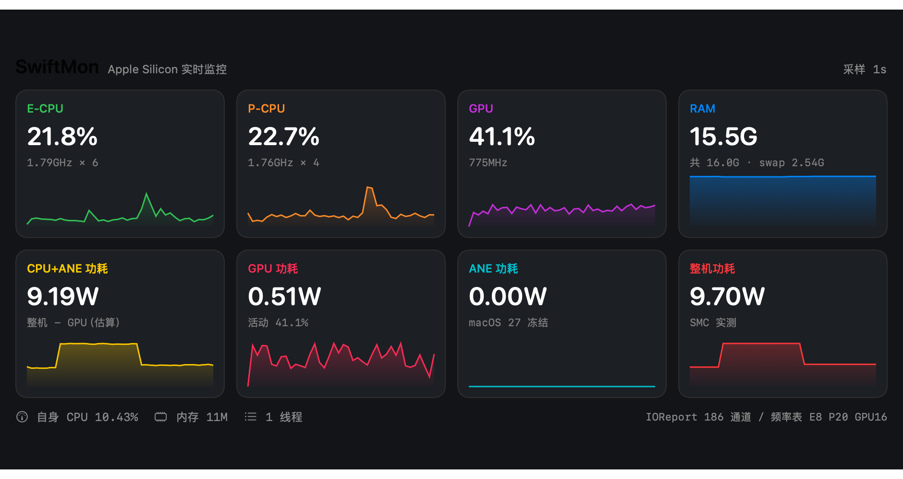
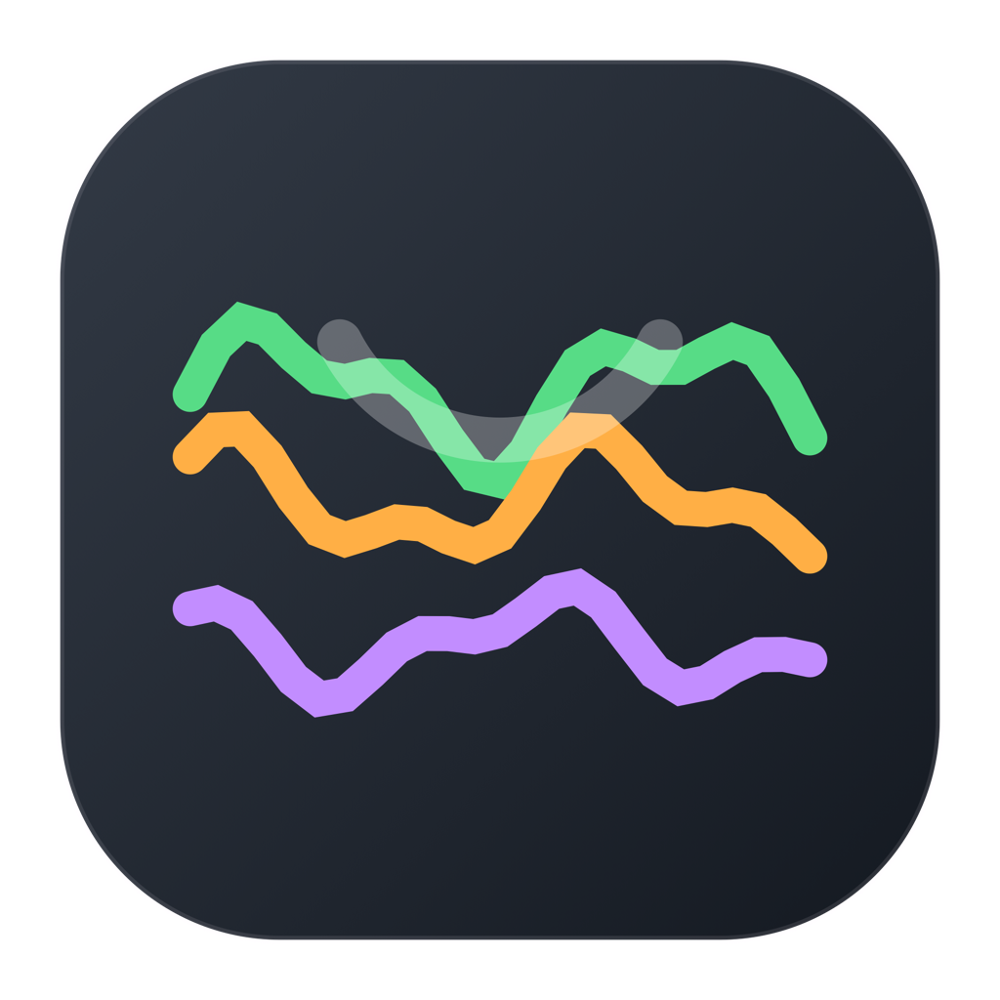

# SwiftMon

[](https://github.com/xitihangto/SwiftMon/actions/workflows/build.yml)
[](LICENSE)


面向 Apple Silicon 的终端级系统监控，但做成原生窗口：**CPU 簇占用/频率、GPU 占用/频率、功耗、内存、swap**，
数据直接来自 IOReport 私有框架与 SMC，**不依赖 `powermetrics`、不需要 sudo、常驻 CPU < 0.5%**。

界面逻辑参考 [macmon](https://github.com/vladkens/macmon) 的 TUI：上排是「各 CPU 簇 + GPU + RAM」，
下排是「CPU / GPU / ANE / 整机功耗」，每格都是标题 + 大数字 + 历史曲线。



一句话验收标准：**监控器自己不能吃掉被监控的资源**——窗口底部常显「自身 CPU / 内存 / 线程数」，
实测 0.2–0.3% CPU、102 MB RSS。

## 功能

| 指标 | 来源 | 状态 |
|---|---|---|
| E 核 / P 核 占用 + 平均频率 | IOReport `CPU Stats` / `CPU Core Performance States` 驻留 + pmgr DVFS 表 | ✅ 实测对齐 `top` |
| GPU 占用 + 平均频率 | IOReport `GPU Stats` / `GPU Performance States` → `GPUPH` | ✅ |
| GPU 功耗 | IOReport `Energy Model` → `GPU Energy` (nJ) | ✅ |
| 整机功耗 | SMC `PSTR` / `PDTR` / `PD0R`（float, W） | ✅ |
| CPU+ANE 功耗 | 整机 − GPU（估算，见下方说明） | ⚠️ 估算 |
| ANE 功耗 | IOReport `Energy Model` → `ANE` | ⚠️ macOS 27 上恒为 0 |
| 内存 / swap / 压缩 | `host_statistics64` + `sysctl vm.swapusage` | ✅ 实测对齐 `top` |
| 自身开销自监控 | `getrusage` + `task_info` | ✅ |

底部状态栏常显「自身 CPU / 内存 / 线程数」，这就是这个监控器的验收指标：
**自监控的开销必须接近 0，否则它本身就不合格。**

## 布局（与 macmon 的对应关系）

macmon 的 TUI 是「上排 = 各 CPU 簇 + GPU + RAM，下排 = CPU/GPU/ANE/总功耗，每格是标题 + 历史曲线」，
这里一一对应：

```
上排：E-CPU | P-CPU | GPU | RAM
下排：CPU+ANE 功耗 | GPU 功耗 | ANE 功耗 | 整机功耗
```

每格都是：标题（着色）+ 大数字 + 一行细节 + 120 点环形缓冲的 sparkline。

## 运行

```bash
swift build -c release

# 图形界面
.build/release/SwiftMon

# 文本模式（每行一帧，便于和系统工具交叉核对）
.build/release/SwiftMon --dump 5 1      # 5 帧，间隔 1 秒

# 离屏渲染界面图（不需要屏幕录制权限，用于自检）
.build/release/SwiftMon --snapshot /tmp/swiftmon.png
```

## 打包成 .app（带图标）



SPM 产物是裸可执行文件，macOS 会给它套通用的 unix executable 图标（就是你看到的那个「终端样」图标）。
要正常图标和 Dock 行为，打成 bundle：

```bash
./scripts/make-app.sh              # 生成 build/SwiftMon.app
./scripts/make-app.sh --install    # 顺便装到 /Applications
open build/SwiftMon.app
```

图标由 `scripts/make-icon.swift` 现画（深色圆角底 + E/P/GPU 三色 sparkline + 仪表弧），
再用 `sips` 生成 10 个尺寸、`iconutil` 合并成 `AppIcon.icns`；`Info.plist` 里
`CFBundleIconFile=AppIcon`、bundle id 为 `local.swiftmon.app`。

## 验收记录（本机：Apple M4 / 16 GB / macOS 27.2）

| 判据 | 结果 |
|---|---|
| `swift build` | 通过，无 error |
| 数值对齐 `top`（CPU） | 本程序 15–24% / `top` 20.9%（同窗口采样） |
| 数值对齐 `top`（内存） | 本程序 15.5–15.8 GB / `top` 15 GB，偏差 <5% |
| 功耗合理性 | SMC 整机 5.8–13.3 W，GPU 0.3–0.5 W（M4 Mac mini 量级正确） |
| 自身开销 | GUI：**CPU 0.3%、RSS 102 MB**；文本模式：**CPU 0.6%、RSS 11 MB** |
| UI 渲染 | `--snapshot` 输出 940×500 @2x PNG，8 张卡片与曲线均正常绘制 |
| 打包 | `plutil -lint` 通过；`AppIcon.icns` 含 10 个尺寸；`open SwiftMon.app` 后窗口 940×508 正常 |

## 实现要点（踩过的坑）

1. **不要手工过滤 IOReport 通道数组。** `CFArrayCreateMutable` 用默认回调 + 手工拼接通道，
   或在 Swift 里用 `CFDictionary` 桥接通道对象，都会在第二次采样时崩在 `objc_retain` / `__CF_IS_OBJC`：
   通道对象由 IOReport 内部持有，Swift 的 ARC retain/release 会造成过度释放。
   最终方案：**按 group 用 `IOReportCopyChannelsInGroup` 取字典直接订阅**，且通道级 getter
   一律 `UnsafeRawPointer` 传入、`Unmanaged<CFString>?` 返回，全程不让 ARC 介入。
2. **Energy Model 在 macOS 27 上会冻结**：`CPU Energy` / `ANE` / `DRAM` 恒读 0，只有 `GPU Energy`
   （单位 nJ）有值。macmon 用 CLPC / PMP 兜底，但 M4 + macOS 27.2 上这两组通道都不存在，
   所以整机功耗只能走 SMC。
3. **SMC 结构体不要用 Swift 手工打包**（对齐差异 + 字节序）。用 C 桥接（`Sources/SMCBridge`），
   且 SMC 返回的 float 是**主机字节序**，`5c4df040` 直接 memcpy 就是 7.51 W；翻转字节序会得到 1e19。
4. **频率表来自 pmgr**：`voltage-states1-sram`（E 核，kHz）、`voltage-states5-sram`（P 核，kHz）、
   `voltage-states9`（GPU，Hz）。状态驻留按「从高频端对齐」映射到频率表。
5. **电压态结构在 C 里的真实偏移**用 `offsetof` 验证过（`pLimit` 在 12 而不是 10，因为内含 uint32 对齐）。

## 已知限制

- **没有进程列表**（macmon 有）。要做需要 `proc_listallpids` + `proc_pid_rusage` 两帧差分，尚未实现。
- **GPU 占用口径**：这里的百分比是 IOReport 的 `GPUPH` 活跃驻留（含低功耗态），
  会比 `ioreg` 的 `Device Utilization %` 高（实测 41% vs 19%）。两者定义不同，不是 bug。
- **ANE 功耗恒 0**：见上面的 Energy Model 冻结，除非 Apple 恢复计数器或改用 CLPC。
- **温度/风扇未实现**：M4 上常见的 `TC0P`/`TG0P` 等 SMC key 已不存在（返回 132 = key not found）。
- 曲线只保留 120 点（≈2 分钟），不落盘。
- GUI 版常驻 RSS ~100 MB（SwiftUI + AppKit 框架本身），若只想要轻量常驻，
  用 `--dump` 的核心逻辑改造成菜单栏 App 可压到 ~40 MB。

## 目录

```
Package.swift
Sources/
  SMCBridge/           # C 桥接：AppleSMC 读 float key（整机功耗）
  SwiftMon/
    IOReport.swift     # 私有框架 FFI + 按组订阅 + 差分
    FreqTables.swift   # pmgr DVFS 频率表
    SystemStats.swift  # 内存 / swap / 自身开销 / 格式化
    Sampler.swift      # 指标聚合 + 环形缓冲 + ObservableObject
    Views.swift        # SwiftUI 卡片 + Canvas sparkline
    main.swift         # 入口：GUI / --dump / --snapshot
scripts/
  make-icon.swift      # 画图标 → PNG
  make-app.sh          # 组装 SwiftMon.app（Info.plist + icns）
```

## License

[MIT](LICENSE)。`Sources/SMCBridge` 的 SMC 调用方式、以及 IOReport 通道命名/兜底顺序参考了
[macmon](https://github.com/vladkens/macmon)（MIT），这里按同样的协议开源。

## 致谢

布局逻辑与数据源思路参考 [macmon](https://github.com/vladkens/macmon)（MIT）。
